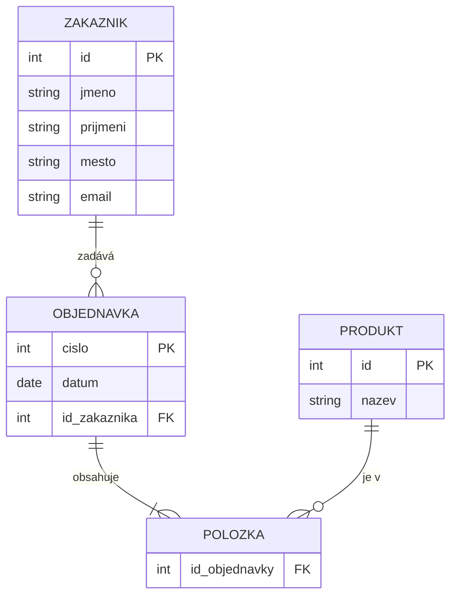

SP1 Kroužky
6

Formátování tabulky je úplně na hovno udělaný. U cen je tam někde napsaný KČ a někde ne, u dnů je po, út, st..... a někde tam je pondělí a čtvrtek, u zaplaceno někde je ano/ne a někde není vůbec nic. Těchto věcí je tam mnoho.

ty tři tabulky rozdělí to první tabulku a k tomu správně





```sql
SELECT nazev, cena
FROM krouzky
WHERE cena > 500;
```